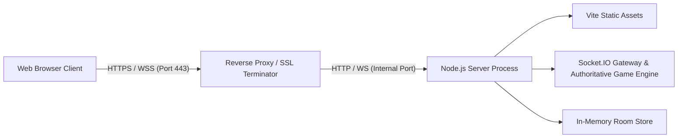

# Mind Clash — Public Production Deployment Guide

This guide provides complete instructions for deploying **Mind Clash** to production on platforms supporting persistent Node.js processes and WebSockets, such as **Render** or **Railway**.

---

## 1. System Architecture in Production

Mind Clash uses a **unified deployment architecture**:
- **Express HTTP Server** serves:
  1. Static compiled Vite React frontend (`client/dist`) at `/`.
  2. Health check endpoints at `/api/health` and `/health`.
  3. Single-page application fallback routing for client routes (`/create`, `/join`, `/lobby`, `/game`).
- **Socket.IO Gateway** attaches to the same HTTP server:
  1. Native WebSocket upgrades (`ws://` / `wss://`) on the same origin without CORS mismatch issues.
  2. Long-polling fallback enabled for restrictive networks.



---

## 2. Critical Operational Limitations

> [!CAUTION]
> **Single Backend Instance Constraint**:
> - Mind Clash's current room, player, and active match state reside in **Node.js process memory**.
> - You **MUST configure exactly ONE (1) backend instance** (replica count = 1).
> - **Do NOT enable horizontal auto-scaling** without adding an external state store (such as Redis) and the `@socket.io/redis-adapter`.
> - **Active games will be lost if the server process restarts** (e.g. during a redeployment or container restart). Clients will receive a restart notification and be directed to the home page.

---

## 3. Platform Options & Expected Costs

| Platform | Recommended Plan | Estimated Cost | WebSocket Behavior | Notes |
| :--- | :--- | :--- | :--- | :--- |
| **Render** | **Starter** Web Service | **$7.00 / month** | Fully persistent; does not spin down | **Recommended**: WebSocket connections stay active indefinitely. |
| **Render** | **Free** Web Service | **$0.00** | Spins down after 15 min of HTTP inactivity | Idle rooms expire; cold start delay on first load. |
| **Railway** | **Hobby** / Trial | **$5.00 / month** (usage-based) | Fully persistent | Continuous connection support, rapid git deploys. |

---

## 4. Required Environment Variables

Configure the following environment variables in your platform dashboard:

| Variable | Recommended Value | Description |
| :--- | :--- | :--- |
| `NODE_ENV` | `production` | Enables production security mode, disables verbose logging, enforces strict CORS. |
| `PORT` | *(Provided by host)* | Render and Railway automatically inject `PORT` (e.g. 10000 on Render). Defaults to `3001` if unset. |
| `CLIENT_ORIGIN` | `https://<your-deployment-url>` | Allowed origin(s) for CORS. (The server automatically permits Render's `RENDER_EXTERNAL_URL`, `RENDER_EXTERNAL_HOSTNAME`, `*.onrender.com`, and Railway's `RAILWAY_PUBLIC_DOMAIN`). |
| `MAX_ROOM_IDLE_MINUTES` | `15` | Minutes of inactivity before abandoned rooms and disconnected player sessions are purged from memory. |
| `VITE_PUBLIC_URL` | `https://<your-deployment-url>` | *(Optional)* Explicit public website URL for room invite links (defaults to current browser origin `window.location.origin`). |

---

## 5. Deployment Instructions

### Option A: Deploying on Render (Recommended)

#### Method 1: Using Render Blueprint (`render.yaml`)
1. Log in to [Render](https://dashboard.render.com).
2. Click **New +** → **Blueprint**.
3. Connect your GitHub repository (`https://github.com/Sampath-2004/Mind-Clash`).
4. Render will detect the included [`render.yaml`](./render.yaml).
5. Select the **Starter** plan ($7/mo) for continuous persistent WebSockets, or **Free**.
6. Click **Apply**. Render will automatically run `npm install && npm run build` and launch with `npm start`.

#### Method 2: Manual Web Service Setup on Render
1. Click **New +** → **Web Service**.
2. Select your repository.
3. Configure the following settings:
   - **Name**: `mind-clash`
   - **Region**: Select your preferred region (e.g., US Oregon, Frankfurt).
   - **Branch**: `master`
   - **Runtime**: `Node`
   - **Build Command**: `npm install && npm run build`
   - **Start Command**: `npm start`
   - **Instance Type**: `Starter` ($7/mo) or `Free`
4. Under **Advanced**:
   - **Health Check Path**: `/api/health`
   - **Auto-Deploy**: `Yes`
5. Click **Create Web Service**.

---

### Option B: Deploying on Railway

1. Log in to [Railway](https://railway.app).
2. Click **New Project** → **Deploy from GitHub repo**.
3. Select `Sampath-2004/Mind-Clash`.
4. Railway will automatically detect the configuration in [`railway.json`](./railway.json) or [`Dockerfile`](./Dockerfile).
5. Go to **Settings** → **Networking** → Click **Generate Domain** (gives you a public URL like `mind-clash-production.up.railway.app`).
6. Under **Variables**, add:
   - `NODE_ENV`: `production`
   - `MAX_ROOM_IDLE_MINUTES`: `15`
7. Under **Settings** → **Deploy**:
   - Ensure **Healthcheck Path** is set to `/api/health`.
   - Ensure **Replicas** is set to `1`.

---

### Option C: Deploying via Docker

The included multi-stage [`Dockerfile`](./Dockerfile) builds and packages the application with all dependencies pruned:

```bash
# 1. Build the production image
docker build -t mind-clash:latest .

# 2. Run locally to test
docker run -p 3001:3001 -e NODE_ENV=production -e CLIENT_ORIGIN=http://localhost:3001 mind-clash:latest

# 3. Test healthcheck
curl http://localhost:3001/api/health
```

---

## 6. Post-Deployment Verification Checklist

Once your deployment is live, verify functionality using two independent browser windows:

1. **Verify Health Endpoint**:
   - Visit `https://<your-domain>/api/health`.
   - Expected response: `{"status":"ok","uptime":...,"timestamp":...,"environment":"production"}`.

2. **Verify WebSocket Handshake & Security Headers**:
   - Open browser developer tools → **Network** tab → filter by `WS`.
   - Navigate to `https://<your-domain>/`.
   - Verify connection status in the footer shows `Connected`.
   - Verify response headers include Helmet security headers (`Content-Security-Policy`, `X-Content-Type-Options: nosniff`).

3. **Verify Multiplayer Flow with Two Clients**:
   - **Client 1 (Host)**: Click **Create Room** → Enter nickname → Confirm room code is generated and displayed.
   - **Client 2 (Guest)**: Open private/incognito window → Click **Join Room** → Enter room code and nickname.
   - Confirm both clients see each other in the live lobby roster.
   - **Host**: Click **Start Match**.
   - Confirm both clients transition to the arena simultaneously and can submit answers.
